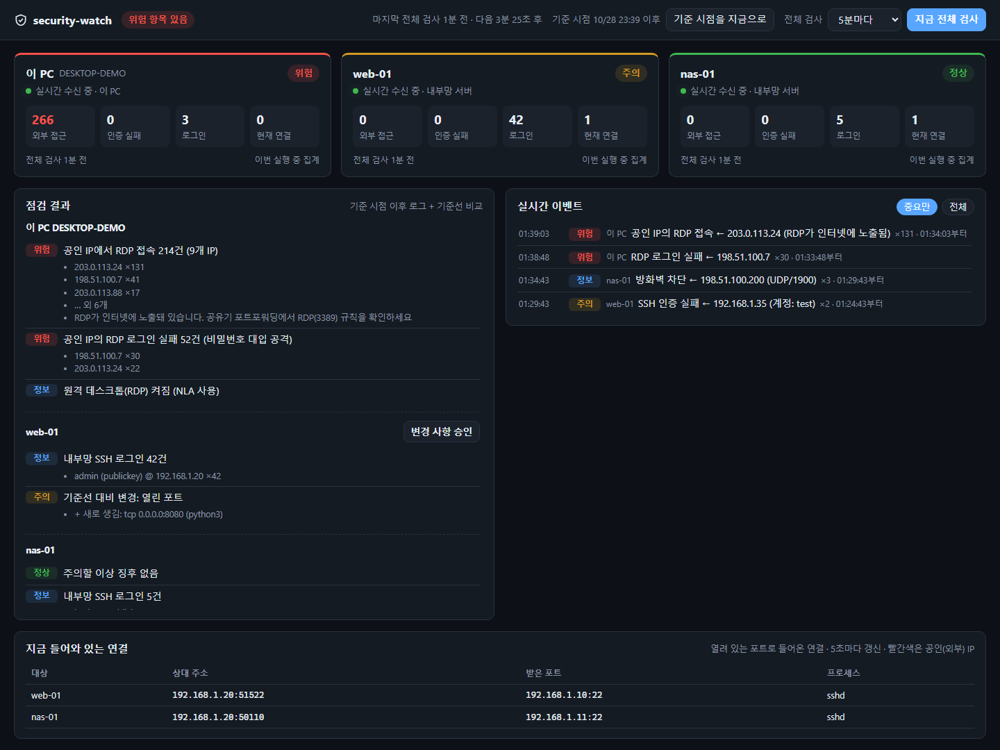

# security-watch

[English](README.md) · **한국어**

Windows PC와, 이 PC에서 SSH로 관리하는 Linux 서버들을 지켜보는 작은 보안 모니터입니다.
더블클릭하면 대시보드 창이 열리고 침투 흔적과 위험한 노출을 실시간으로 보여줍니다.
인터넷에 열린 RDP/SSH, 공인 IP에서 들어온 로그인, 비밀번호 대입 시도, 새로 생긴 계정·키·포트·자동실행 항목 등이 대상입니다.


*대시보드 (데모 데이터, 주소는 문서용 예시)*

- **읽기 전용:** 점검하는 서버와 PC의 상태를 바꾸지 않습니다.
- **최소 의존성:** 창 표시용 `eframe`(egui) 크레이트 하나만 쓰고, 나머지는 Rust 표준 라이브러리와 Windows에 기본으로 있는 `ssh`, PowerShell을 이용합니다. 서버에는 아무것도 설치하지 않으며, SSH로 셸 스크립트를 실행해서 점검합니다.
- **개인 정보 분리:** 호스트 이름, 기준선, 리포트는 git에서 제외되는 폴더에만 저장됩니다.

## 대시보드

| 영역 | 내용 |
|---|---|
| 상단 | 전체 상태, 기준 시점, 전체 검사 주기, "지금 전체 검사" |
| 호스트 카드 | 실시간 연결 상태, 외부 접근·인증 실패·로그인·현재 연결 수 |
| 점검 결과 | 대상별 최근 전체 검사 결과, 기준선 변경 사항과 승인 버튼 |
| 실시간 이벤트 | SSH/RDP 로그인과 실패, sudo 실패, 방화벽 차단, 새 외부 연결, 수상한 프로세스, 처음 외부와 통신하는 프로그램, 백신 탐지 |
| 들어와 있는 연결 | 열린 포트로 들어온 연결, 5초마다 갱신 (공인 IP는 빨간색) |

갱신 주기:

- **실시간 (수 초):** 서버마다 SSH 연결을 하나씩 계속 열어 두고, journal에 기록되는 SSH·sudo·방화벽 이벤트를 발생 즉시 받습니다. 이 PC는 RDP·로그인 이벤트를 5초마다 확인합니다. 같은 출처의 반복 이벤트는 한 줄("×N")로 묶습니다.
- **내부 동작 감시 (수 초):** 같은 실시간 연결로 *무엇이 실행되는지*도 봅니다. 새로 시작된 프로세스와, 어떤 프로그램이 인터넷으로 연결을 여는지 확인합니다(아래 참고).
- **알림:** '위험' 등급 이벤트가 생기면 트레이 알림을 띄우고, 소리를 내고, 작업표시줄 버튼을 깜빡입니다. 창을 보고 있지 않아도 알 수 있습니다. 창의 "알림" 체크박스나 설정의 `alarm off`로 끕니다.
- **정기 전체 검사 (분 단위):** 아래의 무거운 점검을 5분마다(창에서 1~60분으로 변경) 또는 버튼을 누를 때 실행합니다.
- **기준 시점:** "기준 시점을 지금으로"를 누르면 그 이전 로그 기록은 점검 결과에서 빠집니다. 노출을 막은 뒤 누르면, 이미 조치한 과거 공격이 계속 표시되지 않습니다. 기준선 비교와 실시간 이벤트에는 영향이 없습니다.

## 점검 항목

**이 PC (Windows)**
- RDP 켜짐/NLA 여부, **공인 IP**에서 들어온 RDP 접속과 로그인 실패(공유기가 RDP를 인터넷에 열어 둔 신호), 대량 접속으로 이벤트 로그가 덮어써진 흔적, RDP 로그인
- Windows 로그인 실패(이벤트 4625, "관리자 권한으로 실행" 필요)
- Defender 실시간 보호, Windows 방화벽 프로필, OpenSSH 서버
- **BadUSB 감시 (실시간):** Raw Input API로 키 입력이 어느 장치에서 왔는지 구분합니다. 프로그램 실행 중에 새로 꽂힌 키보드형 장치가 Windows 키를 누르거나, Ctrl/Alt 단축키를 보내거나, 사람이 칠 수 없는 속도로 입력하면 '위험'으로 알리고, 꽂은 지 1분 안이면 주입된 명령이 실행되기 전에 **PC를 잠급니다**(설정에 `usb-lock off`를 넣으면 경고만 함). 키 종류와 입력 속도만 보고, 입력한 글자는 기록하지 않습니다. YubiKey가 OTP를 입력하는 건 정상으로 보고, YubiKey가 저장장치·네트워크·시리얼 장치로 인식되면 '위험'으로 표시합니다. 새 USB 저장장치, 네트워크 어댑터, 시리얼 포트 연결도 알립니다.
- **실행 중인 프로세스 (실시간):** Windows 시스템 파일 이름을 엉뚱한 폴더에서 쓰는 프로그램, Office/PDF 프로그램이 명령 창을 띄우는 동작, 기본 도구로 외부 코드를 받아 실행, 백업·복원 지점 삭제, Defender를 끄거나 검사 제외를 추가하는 명령, 명령줄로 계정·관리자 추가, 임시·다운로드 폴더에서 실행되는 서명 없는(또는 서명 후 변조된) 실행 파일
- **외부로 나가는 연결 (실시간):** 처음 보는 프로그램이 인터넷과 통신하면 알리고(서명이 없거나 서명 후 내용이 바뀌었으면 '주의'), 채굴·백도어에서 자주 쓰는 포트로 나가는 연결을 알립니다. 호스트마다 처음 24시간은 학습 기간입니다.
- **백신·시스템 이벤트 (실시간):** Defender 탐지, 보호 기능 꺼짐, 검사 제외 변경, 변조 방지가 막은 시도, 새 서비스 설치, 이벤트 로그 삭제
- 검사 구간 안의 Defender 탐지 기록, 변조 방지 상태, 백신 정의 파일 날짜
- 기준선: 열린 포트, 로컬 계정, 관리자 그룹, Run 키·시작프로그램, Microsoft 외 예약 작업, 자동 시작 서비스, 악성코드가 자주 쓰는 시작 지점(Winlogon shell/userinit, IFEO 디버거, AppInit DLL, LSA 패키지, BootExecute, 로그온 스크립트, 정책 Run 키), hosts 파일 항목, 시스템 프록시

**Linux 서버 (`ssh <별칭>`으로 접속)**
- SSH 실패와 로그인 성공을 공인/내부 IP로 나눠 집계. `lan`(공유기 안쪽)으로 지정한 서버는 공인 IP 접근이 하나라도 있으면 '위험'
- 비밀번호 방식 SSH 로그인, sudo 비밀번호 실패, ufw가 차단한 공인 IP 패킷
- root 외 UID 0 계정, `/etc/ld.so.preload`, `/tmp`·`/dev/shm`에서 실행 중인 프로세스, 임시 폴더의 새 실행 파일(ELF/스크립트), 재부팅 필요 여부
- **실행 중인 프로세스 (실시간):** 가상화폐 채굴 프로그램, 리버스 셸, 커널 스레드 이름을 흉내 낸 프로세스, 메모리에서만 실행되거나 실행 후 파일이 지워진 프로그램, 웹 서버가 셸/다운로더를 실행, `curl | sh`, base64로 숨긴 코드를 셸로 실행
- **외부로 나가는 연결 (실시간):** Windows와 같은 '처음 보는 프로그램'·수상한 포트 점검
- 핵심 패키지(`coreutils`, `openssh`, `sudo`, `bash`, `libc6`, PAM 등)의 설치 파일이 패키지 원본 체크섬과 다른지(`dpkg -V`)
- 기준선: 열린 포트, 로그인 가능한 계정, `authorized_keys` 지문, 중요 파일(`passwd`, `shadow`, `sudoers`, `sshd_config`, PAM), systemd 유닛과 그 내용, cron 작업, 부팅/로그인 스크립트(`/etc/profile.d`, `rc.local`, `ld.so.conf` 등), SUID 프로그램

**한계.** 백신을 보완하는 도구이지 대체하지 않습니다. 파일 검사나 커널 드라이버가 없습니다. 프로세스는 몇 초 간격으로 확인하므로 그보다 짧게 실행되고 끝나는 것은 놓칠 수 있습니다. 관리자 권한(Windows)이나 `sudo`(Linux)가 없으면 자기 계정의 프로세스 정보만 보입니다.

## 설치

1. 빌드: `cargo build --release`
2. git에서 제외되는 개인 폴더를 만들고 exe를 복사합니다.
   ```
   mkdir .private
   copy target\release\security-watch.exe .private\
   ```
3. 한 번 실행하면 `.private\security-watch.conf`가 생깁니다. 서버를 추가합니다.
   ```
   local
   host my-server lan      # ~/.ssh/config의 Host 별칭, 키 인증 접속
   host my-vps public      # 인터넷에 직접 열린 서버: 공인 IP 대입 시도는 '정보'로만 집계
   ```
4. `.private\security-watch.exe`를 더블클릭합니다. 자체 아이콘을 가진 창 하나로 열리고, 일반 프로그램처럼 작업표시줄에 고정할 수 있습니다. 창을 닫으면 프로그램과 `ssh`/PowerShell 보조 프로세스가 함께 종료되고, 실행 중에 다시 실행하면 기존 창이 앞으로 나옵니다.

서버 요구 사항: 비밀번호 입력 없는 키 인증 SSH(`BatchMode`), 그리고 journal 읽기 권한(`adm` 또는 `systemd-journal` 그룹) 또는 비밀번호 없는 `sudo`. journal을 읽을 수 없으면 추측하지 않고 그 사실을 표시합니다. `sudo`가 없으면 다른 사용자의 연결은 프로세스 이름이 "권한 필요"로 나옵니다.

`security-watch.exe --once`는 텍스트 리포트를 한 번 출력하고 `.private\reports\`에 저장합니다(예약 작업용). `--demo`는 가짜 데이터로 창을 보여줍니다.

`security-watch.conf`에 넣을 수 있는 선택 항목:

```
usb-lock off            # BadUSB 감시가 경고만 하고 PC를 잠그지 않음
alarm off               # 트레이 알림·소리 끔
ignore <문구>           # 이 문구가 들어간 실시간 이벤트는 무시 (예: 직접 빌드한 프로그램 폴더)
```

## 파일

```
.private/
  security-watch.conf     점검 대상
  state/<host>.baseline   승인된 기준선
  state/watch_since       기준 시점
  state/<host>.outproc    이미 외부 통신이 확인된 프로그램 목록
  state/<host>.lastrun    마지막 검사 구간 끝 (--once)
  reports/report-*.txt    --once 리포트
```

exe가 있는 폴더에 `security-watch.conf`가 있으면 그 폴더를 대신 쓰므로, exe만 복사해서 다른 곳에서도 쓸 수 있습니다.

## 보안 설계

- 대시보드는 네이티브 창입니다. 웹서버나 열린 포트가 없어서 다른 프로그램이 접근할 통로가 없습니다.
- 자식 프로세스(`ssh`, PowerShell)는 kill-on-close Job Object 안에서 실행되므로, 프로그램이 강제 종료돼도 남지 않습니다.
- 원격 스크립트는 로그와 시스템 상태를 읽기만 합니다. `src/probe_linux.sh`, `src/live_linux.sh`(Linux), `src/probe_windows.ps1`, `src/live_windows.ps1`(이 PC)에서 확인할 수 있습니다.

## 라이선스

MIT
