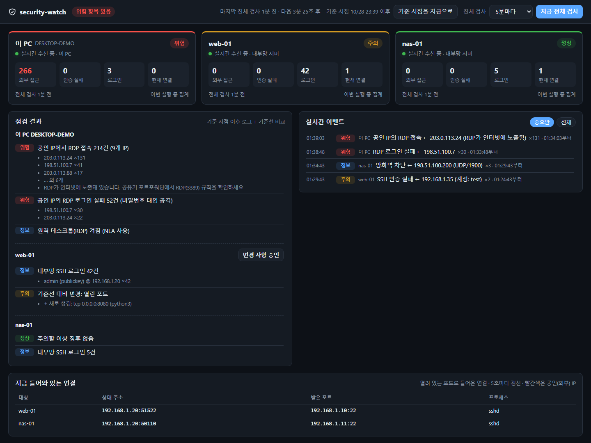

# security-watch

**English** · [한국어](README.ko.md)

A small security monitor for a Windows PC and the Linux servers it manages over SSH.
Double-click it and a dashboard window shows intrusion traces and risky exposure, live:
RDP/SSH reachable from the internet, logins from public IPs, password-guessing, new
accounts, keys, ports and autoruns.


*Dashboard (demo data; addresses are documentation examples)*

- **Read-only.** It never changes anything on the hosts it checks.
- **Minimal dependencies.** One crate, `eframe` (egui), for the native window; everything
  else is the Rust standard library plus `ssh` and PowerShell, which ship with Windows.
  Servers need nothing installed; checks run as shell scripts over SSH.
- **Private by default.** Host names, baselines and reports stay in a git-ignored folder.

## Dashboard

| Area | What it shows |
|---|---|
| Header | Overall status, reference point, full-scan interval, "scan now" |
| Host cards | Live link state; external access, auth failures, logins, current connections |
| Findings | Results of the last full scan per host, baseline changes with an accept button |
| Live events | SSH/RDP logins and failures, sudo failures, firewall blocks, new public connections |
| Connections | Inbound connections to listening ports, refreshed every 5 s (public IPs in red) |

How fresh the data is:

- **Live (seconds):** one long-lived `ssh` session per server follows SSH, sudo and
  firewall events from the journal as they happen. This PC is polled every 5 s for RDP and
  logon events. Repeats from one source fold into a single "×N" row.
- **Full scans (minutes):** the heavier checks below run every 5 minutes (1–60, set in the
  window) or on demand.
- **Reference point:** "기준 시점을 지금으로" (reset reference point) hides log entries
  older than now, for example after you fixed an exposure, so attacks you already handled
  stop showing up. Baseline comparison and live events are not affected.

## What it checks

**This PC (Windows)**
- RDP enabled/NLA; inbound RDP connections and failed logins from **public IPs** (a sign the
  router forwards RDP to the internet); event-log rollover caused by floods; RDP logons
- Failed Windows logons (event 4625, needs "Run as administrator")
- Defender real-time protection, Windows Firewall profiles, OpenSSH server
- **BadUSB guard (live):** with the Raw Input API it knows which device each keystroke came
  from. A keyboard-type device plugged in while the app runs that presses the Windows key,
  sends Ctrl/Alt shortcuts or types at machine speed raises an alert, and within a minute of
  plug-in **locks the PC** before an injected command can run (`usb-lock off` in the config
  to only warn). Only key classes and timing are inspected; typed characters are never
  recorded. A YubiKey typing its OTP is expected; a YubiKey that shows up as storage, a
  network adapter or a serial port is flagged. New USB storage, network adapters and serial
  ports are reported.
- Baseline: listening ports, local accounts, Administrators group, Run keys and Startup
  folder, non-Microsoft scheduled tasks, auto-start services

**Linux servers (via `ssh <alias>`)**
- SSH failures and successful logins split by public/private source. Hosts marked `lan`
  (behind the router) raise an alert on any public-IP access.
- Password-based SSH logins, sudo password failures, public packets blocked by ufw
- Extra UID 0 accounts, `/etc/ld.so.preload`, processes running from `/tmp` or `/dev/shm`,
  new ELF/script files in temp folders, pending reboot
- Baseline: listening ports, login-capable users, `authorized_keys` fingerprints, sensitive
  files (`passwd`, `shadow`, `sudoers`, `sshd_config`, PAM), systemd units, cron jobs

## Setup

1. Build: `cargo build --release`
2. Create the private folder (git-ignored) and copy the exe there:
   ```
   mkdir .private
   copy target\release\security-watch.exe .private\
   ```
3. Run it once; it creates `.private\security-watch.conf`. Add your servers:
   ```
   local
   host my-server lan      # Host alias from ~/.ssh/config, key-based login
   host my-vps public      # internet-facing: public brute force is only "info"
   ```
4. Double-click `.private\security-watch.exe`. It opens one native window with its own icon
   (pin it to the taskbar like any app). Closing the window stops the program and its
   `ssh`/PowerShell helpers; starting it again while it runs brings the window back.

Requirements for servers: key-based SSH without a password prompt (`BatchMode`), and read
access to the journal (`adm` or `systemd-journal` group) or passwordless `sudo`. Without
journal access the dashboard says so instead of guessing. Without `sudo`, process names of
other users' connections show as "권한 필요" (permission needed).

`security-watch.exe --once` prints a one-shot text report and saves it under
`.private\reports\` (useful for scheduled tasks). `--demo` shows the window with fake data.

## Files

```
.private/
  security-watch.conf     hosts to check
  state/<host>.baseline   accepted baseline
  state/watch_since       reference point
  state/<host>.lastrun    end of the last window (--once)
  reports/report-*.txt    --once reports
```

If the exe's own folder contains `security-watch.conf`, that folder is used instead, so a
copied exe works anywhere.

## Security design

- The dashboard is a native window: no web server and no open port for other programs to
  talk to.
- All child processes (`ssh`, PowerShell) run in a kill-on-close job object, so nothing is
  left behind even if the program is killed.
- The remote scripts only read logs and system state; see `src/probe_linux.sh` and
  `src/live_linux.sh`.

## License

MIT
